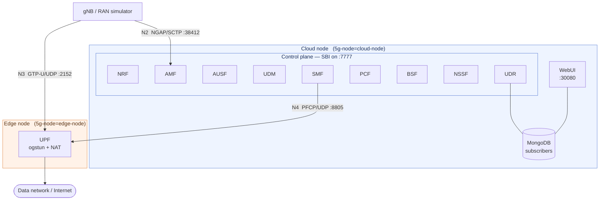

# Open5GS 5G Core on Kubernetes

[](https://helm.sh)
[](https://kubernetes.io)
[](https://open5gs.org)
[](LICENSE)

A Helm chart that deploys a complete **Open5GS 5G Standalone (SA) core network** on Kubernetes, designed for
edge-computing research and testbeds. Unlike a flat single-cluster deployment, this chart treats the **User Plane
Function as a relocatable component**: the UPF can be pinned to edge nodes while the control plane stays in the
cloud, which is the topology that matters for low-latency MEC use cases.

## Why this chart

Most Open5GS-on-Kubernetes charts deploy all network functions as interchangeable pods on whatever node the
scheduler picks. That is fine for a functional test and useless for studying edge offload. This chart adds the
pieces that a real edge testbed needs:

- **Distributed UPF placement** — a single flag moves the UPF to edge nodes while the control plane (AMF, SMF,
  NRF, …) stays in the cloud, so you can measure the latency difference that edge user-plane placement buys you.
- **External N3 exposure** — GTP-U is published through MetalLB `LoadBalancer` or `NodePort`, so a real gNB
  outside the cluster can attach.
- **SCTP-aware N2** — the NGAP service is declared with `protocol: SCTP`, which most charts get wrong.
- **Network slicing** — S-NSSAI lists on the AMF and an NSSF `nsi_list`, so you can run more than one slice.
- **Prometheus integration** — AMF and SMF metrics endpoints with `ServiceMonitor` resources for
  kube-prometheus-stack.
- **Automated subscriber provisioning** — a post-install Helm hook imports subscribers into MongoDB, so a fresh
  install comes up with UEs already registered instead of requiring manual WebUI clicks.
- **TUN device bootstrapping** — an init container creates the `ogstun` devices, sets up IP forwarding and
  installs the `MASQUERADE` rule for each configured DNN.

## Architecture



When `upf.distributed_upf.enabled` is `false`, the UPF is scheduled with the same node selector as the rest of
the core and the deployment collapses into a single-site topology.

## What gets deployed

| Component | Kind | Interfaces exposed | Notes |
|---|---|---|---|
| **NRF** | Deployment + ClusterIP | SBI `7777` | Service discovery; every NF registers here |
| **AMF** | Deployment + ClusterIP + NodePort | SBI `7777`, NGAP `38412/SCTP`, metrics `9090` | N2 termination, `ServiceMonitor` included |
| **AUSF** | Deployment + ClusterIP | SBI `7777` | Authentication |
| **UDM** | Deployment + ClusterIP | SBI `7777` | Optional home-network public-key (`hnet`) support |
| **UDR** | Deployment + ClusterIP | SBI `7777` | Backed by MongoDB |
| **PCF** | Deployment + ClusterIP | SBI `7777` | Policy |
| **BSF** | Deployment + ClusterIP | SBI `7777` | Binding support |
| **NSSF** | Deployment + ClusterIP | SBI `7777` | Slice selection via `nsi_list` |
| **SMF** | Deployment + ClusterIP | SBI `7777`, PFCP `8805/UDP`, metrics `9090` | Session management, `ServiceMonitor` included |
| **UPF** | Deployment + ClusterIP + LB/NodePort | PFCP `8805/UDP`, GTP-U `2152/UDP` | Privileged; creates TUN devices, relocatable to edge |
| **MongoDB** | Deployment + ClusterIP | `27017` | Subscriber database |
| **WebUI** | Deployment + NodePort | `3000` → `30080` | Open5GS subscriber management UI |

## Prerequisites

- Kubernetes **1.24+** with a CNI that supports `NET_ADMIN` and privileged pods (the UPF needs both to create
  its TUN devices).
- **Helm 3**.
- **MetalLB** (or another `LoadBalancer` provider) if you want external GTP-U through a load balancer. Otherwise
  set `upf.service.nodeport.enabled: true` and use a `NodePort`.
- **kube-prometheus-stack** if you want the `ServiceMonitor` resources to be picked up.
- Nodes labelled for placement:

  ```bash
  kubectl label node <cloud-node> 5g-node=cloud-node
  kubectl label node <edge-node>  5g-node=edge-node   # only for distributed UPF
  ```

### Container image

This chart expects an Open5GS container image that bundles the `open5gs-*d` binaries under `/open5gs/install/bin`.
There is no public image pinned by default — set `open5gs.image.repository` to your own registry. Build one from
the [upstream Open5GS sources](https://github.com/open5gs/open5gs) and push it before installing:

```bash
helm install open5gs ./open5gs-helm-chart \
  --set open5gs.image.repository=<registry>/open5gs \
  --set open5gs.image.tag=2.6.1
```

## Quick start

```bash
git clone https://github.com/mdalgitsis/open5gs.git
cd open5gs

# Label at least one node for the control plane
kubectl label node <node> 5g-node=cloud-node

# Review and edit the values you need (image repository, MetalLB IP, PLMN)
$EDITOR open5gs-helm-chart/values.yaml

helm install open5gs ./open5gs-helm-chart --namespace open5gs --create-namespace
kubectl get pods -n open5gs -o wide -w
```

Bring-up order is handled by the NRF being reachable first; NFs that start before it retry their registration.

## Configuration

### Core identity and slicing

| Value | Default | Description |
|---|---|---|
| `amf.configuration.mcc` | `001` | Mobile Country Code |
| `amf.configuration.mnc` | `01` | Mobile Network Code |
| `amf.configuration.tac` | `100` | Tracking Area Code |
| `amf.configuration.slice_sst_sd_list` | `[{sst: 1}]` | S-NSSAIs advertised by the AMF |
| `nssf.configuration.nsi_list` | NRF at `nrf-svc:7777`, `sst: 1` | Network slice instances known to the NSSF |

To run a second slice, add the S-NSSAI to both the AMF list and the NSSF `nsi_list`:

```yaml
amf:
  configuration:
    slice_sst_sd_list:
      - sst: 1
      - sst: 1
        sd: "000001"
```

### Data networks

| Value | Default | Description |
|---|---|---|
| `smf.configuration.subnet_list` | `10.45.0.1/16` → `internet` | UE address pools per DNN |
| `smf.configuration.dns_list` | `8.8.8.8`, `8.8.4.4` | DNS servers signalled to UEs |
| `smf.configuration.mtu` | `1400` | UE MTU |
| `upf.configuration.subnet_list` | `10.45.0.1/16` → `internet` on `ogstun0` | Must mirror the SMF pools; `dev` names the TUN device |

`values.yaml` ships commented examples for a second DNN (`10.46.0.1/16` on `ogstun1`). Uncomment the matching
entries in **both** the SMF and UPF lists — a mismatch shows up as sessions that establish and then blackhole.

### Distributed UPF (edge placement)

```yaml
upf:
  distributed_upf:
    enabled: true
    node_selector:
      5g-node: "edge-node"
```

With this enabled the UPF pod is scheduled onto edge-labelled nodes while every control-plane NF stays on the
cloud nodes. N4 (PFCP) then crosses the cloud–edge link, and N3 (GTP-U) terminates at the edge — which is the
whole point: user traffic never traverses the backhaul to the central site.

### External N3 exposure

```yaml
upf:
  service:
    loadbalancer:
      enabled: true
      loadBalancerIP: 10.0.0.50     # must sit inside your MetalLB pool
    nodeport:
      enabled: false                # set true to use a NodePort instead
```

> The chart selects `NodePort` when `upf.service.nodeport.enabled` is `true`, and the `LoadBalancer` type
> otherwise. Set `loadBalancerIP` to an address your provider actually owns, or the service stays `<pending>`.

### Monitoring

```yaml
amf: { configuration: { metrics: { enabled: true, interval: "5s" } } }
smf: { configuration: { metrics: { enabled: true, interval: "5s" } } }
global_config:
  monitoring:
    prometheus:
      release:
        name: "prometheus-5g"     # must match your kube-prometheus-stack release
```

The `release` label on each `ServiceMonitor` has to match the label your Prometheus operator selects on, or the
targets are created and silently ignored.

### Subscriber provisioning

```yaml
add_subs_auto:
  helm_post_hook:
    enabled: true
    image:
      repository: <registry>/mongo-tools
      tag: "0.0.1"
```

When enabled, a post-install `Job` waits for the WebUI to return HTTP 200, then `mongoimport`s the subscriber
list from the `mongodb-subs-cmap` ConfigMap. Edit that ConfigMap to change IMSIs, keys (`K`/`OPc`) and slice
assignments. The hook image needs `curl` and `mongoimport` on its `PATH`.

### Private registries

```yaml
global_config:
  imagePullSecret:
    enabled: true
    name: open5gs-project-secret
    image_secret_creator:
      enabled: false     # true renders the Secret from the values below
    registry: <registry>
    username: <user>
    password: <password>
```

> **Do not commit credentials.** Leave `image_secret_creator.enabled: false` and create the pull secret out of
> band with `kubectl create secret docker-registry`, or pass the values with `--set` at install time.

## Verifying the deployment

```bash
kubectl get pods -n open5gs -o wide              # check UPF landed on the expected node
kubectl logs -n open5gs deploy/amf-depl | grep -i "ngap"
kubectl logs -n open5gs deploy/upf-depl -c tun-interface-create
kubectl exec -n open5gs deploy/upf-depl -- ip addr show ogstun0
```

A healthy core shows every NF registered with the NRF, `ogstun0` up with the configured address, and the AMF
listening on SCTP `38412`.

## Troubleshooting

| Symptom | Likely cause |
|---|---|
| UPF `CrashLoopBackOff`, init container exits 1 | `ogstun0` already exists on the host from a previous run, or the CNI blocks privileged pods |
| gNB cannot reach the AMF | NGAP service needs SCTP end to end — check the CNI and any load balancer in front of it |
| Sessions establish but no traffic flows | SMF and UPF `subnet_list` entries disagree, or the `MASQUERADE` rule did not install |
| `ServiceMonitor` created but no targets | `global_config.monitoring.prometheus.release.name` does not match the Prometheus release label |
| Pods stay `Pending` | No node carries the `5g-node` label the chart selects on |

## Known limitations

- The UPF runs **privileged** with `NET_ADMIN`. That is inherent to creating TUN devices and installing iptables
  rules from inside a pod; it is acceptable for a testbed and would need rework for a hardened cluster.
- No `values.schema.json`, so bad values fail at apply time rather than at lint time.
- Deployments have no readiness or liveness probes; NF bring-up relies on NRF registration retries.
- Single-replica NFs — there is no HA story here.

## Acknowledgements

This chart was developed in the context of applied research on edge-cloud 5G deployments. The Open5GS project
itself is authored and maintained by [Sukchan Lee and contributors](https://github.com/open5gs/open5gs); this
repository contains only the Kubernetes packaging and the edge-placement work around it.

In the environments where it was validated, lifecycle management and multi-site orchestration were handled by a
separate commercial orchestration platform. That integration layer is proprietary and deliberately out of scope
here — this chart stands alone and installs with nothing but Helm.

## License

[Apache License 2.0](LICENSE). Open5GS itself is distributed under the AGPL-3.0 license; this chart packages it
but is not a derivative work of it.
