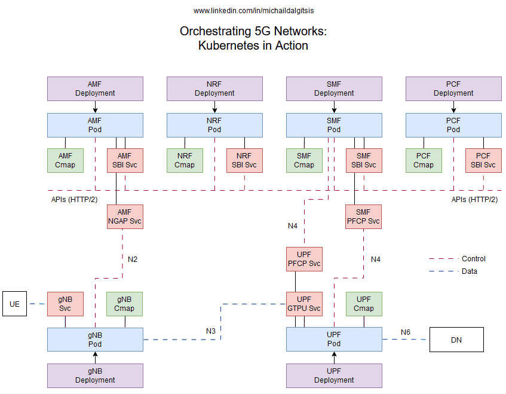
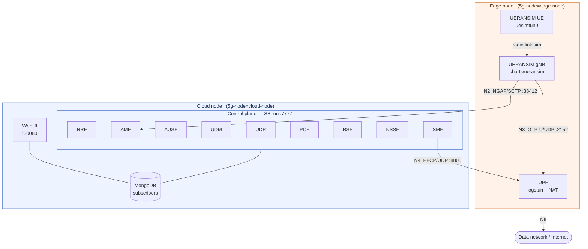

# Open5GS 5G Core on Kubernetes

[](https://github.com/mdalgitsis/open5gs-k8s/actions/workflows/helm-lint.yml)
[](https://helm.sh)
[](https://kubernetes.io)
[](https://open5gs.org)
[](LICENSE)

A complete, runnable **5G Standalone testbed on Kubernetes**: the Open5GS core, a simulated RAN and UE, subscriber
provisioning, and a relocatable User Plane Function you can pin to edge nodes. Built for edge-computing research,
and packaged so someone else can actually reproduce it.

<p align="center">
  
</p>
<p align="center"><em>3GPP reference points mapped onto Kubernetes objects. Boxes are Deployments, Pods,
Services and ConfigMaps; dashed lines trace the control-plane (red) and user-plane (blue) paths.</em></p>

## Research context

The testbed behind these charts backs two peer-reviewed publications on network slice federation:

> **[1]** M. Dalgitsis, N. Cadenelli, M. A. Serrano, N. Bartzoudis, L. Alonso, A. Antonopoulos,
> "NSFaaS: Network Slice Federation as a Service in Cloud-Native 5G and Beyond Mobile Networks,"
> *2023 IEEE Conference on Network Function Virtualization and Software Defined Networks (NFV-SDN)*,
> pp. 59–64, 2023. [doi:10.1109/NFV-SDN59219.2023.10329748](https://doi.org/10.1109/NFV-SDN59219.2023.10329748)

> **[2]** M. Dalgitsis, N. Cadenelli, M. A. Serrano, N. Bartzoudis, L. Alonso, A. Antonopoulos,
> "Cloud-Native Orchestration Framework for Network Slice Federation Across Administrative Domains in 5G/6G
> Mobile Networks," *IEEE Transactions on Vehicular Technology*, vol. 73, pp. 9306–9319, 2024.
> [doi:10.1109/TVT.2024.3362583](https://doi.org/10.1109/TVT.2024.3362583)

The S-NSSAI slicing support and the cloud/edge UPF split documented below are the mechanisms those papers measure.

## Why this repository

Most Open5GS-on-Kubernetes charts deploy every network function as an interchangeable pod on whatever node the
scheduler picks. That is fine for a functional test and useless for studying edge offload. This repository adds
the pieces a real edge testbed needs:

- **Distributed UPF placement** — one flag moves the UPF to edge nodes while the control plane stays in the
  cloud, so the latency difference that edge user-plane placement buys you is actually measurable.
- **A second, independent UPF** — [`charts/upf`](charts/upf) deploys an additional UPF at another site on its own
  DNN and TUN device, registering back to the central SMF over N4. That is the multi-site offload topology.
- **External N3 exposure** — GTP-U published through MetalLB `LoadBalancer` or `NodePort`, so a real or simulated
  gNB outside the cluster can attach.
- **SCTP-aware N2** — the NGAP service is declared `protocol: SCTP`, which most charts get wrong.
- **Network slicing** — S-NSSAI lists on the AMF, an NSSF `nsi_list`, and per-subscriber slice assignment.
- **Prometheus integration** — AMF and SMF metrics endpoints with `ServiceMonitor` resources.
- **A simulated RAN and UE** — [`charts/ueransim`](charts/ueransim) runs UERANSIM so you can drive real traffic
  through the core without hardware.
- **Reproducible images** — [`docker/`](docker/) holds every Dockerfile the charts depend on.

## Repository layout

```
charts/
  open5gs/       Full 5G SA core: NRF AMF AUSF UDM UDR PCF BSF NSSF SMF UPF + MongoDB + WebUI
  upf/           Standalone UPF for a second site, on its own DNN and TUN device
  ueransim/      UERANSIM gNodeB and UE simulator
  subscribers/   Subscriber import job, usable independently of the core install
docker/          Dockerfiles for Open5GS 2.4.8-2.6.6, the WebUI, UERANSIM and the import tooling
deploy/metallb/  IPAddressPool and L2Advertisement examples for exposing GTP-U
docs/images/     Diagrams
```

## Architecture



With `upf.distributed_upf.enabled: false` the UPF is scheduled alongside the control plane and the topology
collapses to a single site.

## Charts

| Chart | Purpose | Key values |
|---|---|---|
| [`charts/open5gs`](charts/open5gs) | The whole core plus MongoDB and the WebUI | `upf.distributed_upf`, `amf.configuration.slice_sst_sd_list`, `smf.configuration.subnet_list` |
| [`charts/upf`](charts/upf) | A second UPF at another site, DNN `internet2` on `ogstun2` | `upf.configuration.pfcp_smf_connection_list`, `upf.service.loadbalancer` |
| [`charts/ueransim`](charts/ueransim) | gNodeB + UE simulator | `gnb.amf.ip`, `ue.key`, `ue.apnList`, `slices` |
| [`charts/subscribers`](charts/subscribers) | Import subscribers into MongoDB | `subscriber_info` |

## What the core chart deploys

| Component | Interfaces exposed | Notes |
|---|---|---|
| **NRF** | SBI `7777` | Service discovery; every NF registers here |
| **AMF** | SBI `7777`, NGAP `38412/SCTP`, metrics `9090` | N2 termination, `ServiceMonitor` included |
| **AUSF** / **UDM** / **UDR** | SBI `7777` | Authentication and subscriber data; UDR backed by MongoDB |
| **PCF** / **BSF** | SBI `7777` | Policy and binding support |
| **NSSF** | SBI `7777` | Slice selection via `nsi_list` |
| **SMF** | SBI `7777`, PFCP `8805/UDP`, metrics `9090` | Session management, `ServiceMonitor` included |
| **UPF** | PFCP `8805/UDP`, GTP-U `2152/UDP` | Privileged; creates TUN devices, relocatable to edge |
| **MongoDB** | `27017` | Subscriber database |
| **WebUI** | `3000` → NodePort `30080` | Subscriber management UI (default login `admin` / `1423`) |

## Prerequisites

- Kubernetes **1.24+** with a CNI that permits `NET_ADMIN` and privileged pods — the UPF and the UERANSIM UE both
  create TUN devices.
- **Helm 3**.
- **MetalLB** or another `LoadBalancer` provider for external GTP-U. Otherwise set
  `upf.service.nodeport.enabled: true`. Examples live in [`deploy/metallb`](deploy/metallb) — edit the address
  range to one your network actually owns before applying.
- **kube-prometheus-stack** if you want the `ServiceMonitor` resources picked up.
- Nodes labelled for placement:

  ```bash
  kubectl label node <cloud-node> 5g-node=cloud-node
  kubectl label node <edge-node>  5g-node=edge-node   # only for distributed UPF / RAN
  ```

## Container images

No public image is pinned, but **every Dockerfile the charts need is in this repository** — see
[`docker/`](docker/).

```bash
docker build -t <registry>/open5gs:2.6.1  docker/open5gs/2.6.1
docker build -t <registry>/ueransim:3.2.6 docker/ueransim
docker push  <registry>/open5gs:2.6.1
docker push  <registry>/ueransim:3.2.6
```

> Open5GS builds **before 2.5.9** omit the Prometheus metrics implementation. Use 2.5.9 or later or the
> ServiceMonitors will be created and scrape nothing.

## End-to-end bring-up

```bash
git clone https://github.com/mdalgitsis/open5gs-k8s.git
cd open5gs-k8s
kubectl label node <node> 5g-node=cloud-node
```

**1. Deploy the core.**

```bash
helm install open5gs charts/open5gs -n open5gs --create-namespace \
  --set open5gs.image.repository=<registry>/open5gs \
  --set open5gs.image.tag=2.6.1 \
  --set upf.service.loadbalancer.loadBalancerIP=<ip-in-your-metallb-pool>

kubectl get pods -n open5gs -o wide -w
```

**2. Add subscribers.** Either enable the post-install hook on the core chart, or run the standalone chart —
whose IMSIs must match what the UE will present:

```bash
helm install subs charts/subscribers -n open5gs \
  --set add_subscribers.image.repository=<registry>/open5gs-subscribers
```

**3. Attach a simulated RAN and UE.**

```bash
helm install ueransim charts/ueransim -n open5gs \
  --set ueransim.image.repository=<registry>/ueransim \
  --set gnb.amf.ip=<node-ip-exposing-the-ngap-nodeport> \
  --set gnb.start_gnb.enabled=true \
  --set ue.start_ue.enabled=true
```

Leave `start_gnb` / `start_ue` off to get shells you can drive by hand:

```bash
kubectl exec -it -n open5gs deploy/gnb-depl -- ./nr-gnb -c config/open5gs-gnb.yaml
kubectl exec -it -n open5gs deploy/ue-depl  -- ./nr-ue  -c config/open5gs-ue.yaml
```

**4. Verify the session carries traffic.** The UE gets a `uesimtun0` interface; bind to it:

```bash
kubectl exec -it -n open5gs deploy/ue-depl -- ping -I uesimtun0 8.8.8.8
kubectl exec -it -n open5gs deploy/ue-depl -- curl --interface uesimtun0 https://example.com/
```

Traffic leaving `uesimtun0` has traversed the full path: radio-link simulation → gNB → N3 GTP-U → UPF → NAT → N6.

## Configuration

### Core identity and slicing

| Value | Default | Description |
|---|---|---|
| `amf.configuration.mcc` / `.mnc` | `001` / `01` | PLMN identity — must match `plmn` in the UERANSIM chart |
| `amf.configuration.tac` | `100` | Tracking Area Code |
| `amf.configuration.slice_sst_sd_list` | `[{sst: 1}]` | S-NSSAIs advertised by the AMF |
| `nssf.configuration.nsi_list` | NRF at `nrf-svc:7777`, `sst: 1` | Slice instances known to the NSSF |

A slice has to be declared consistently in **four** places or attach fails: the AMF list, the NSSF `nsi_list`,
the subscriber's `slice` in `charts/subscribers`, and the UE's `apnList[].slice` in `charts/ueransim`.

```yaml
amf:
  configuration:
    slice_sst_sd_list:
      - sst: 1
      - sst: 1
        sd: "000001"
```

### Data networks

| Value | Default | Description |
|---|---|---|
| `smf.configuration.subnet_list` | `10.45.0.1/16` → `internet` | UE address pools per DNN |
| `smf.configuration.dns_list` | `8.8.8.8`, `8.8.4.4` | DNS signalled to UEs |
| `smf.configuration.mtu` | `1400` | UE MTU |
| `upf.configuration.subnet_list` | `10.45.0.1/16` → `internet` on `ogstun0` | Must mirror the SMF pools; `dev` names the TUN device |

`values.yaml` ships commented examples for a second DNN (`10.46.0.1/16` on `ogstun1`). Uncomment the matching
entries in **both** SMF and UPF lists — a mismatch shows up as sessions that establish and then blackhole.

### Distributed UPF (edge placement)

```yaml
upf:
  distributed_upf:
    enabled: true
    node_selector:
      5g-node: "edge-node"
```

N4 then crosses the cloud–edge link while N3 terminates at the edge, so user traffic never traverses the backhaul
to the central site.

### A second UPF at another site

[`charts/upf`](charts/upf) installs an independent UPF serving DNN `internet2` on `ogstun2`, pointing back at the
central SMF:

```bash
helm install upf-edge charts/upf -n open5gs \
  --set open5gs.image.repository=<registry>/open5gs \
  --set upf.distributed_upf.enabled=true
```

> If that UPF runs in a **different cluster** from the SMF, `upf.configuration.pfcp_smf_connection_list[].name`
> cannot stay a ClusterIP service name — expose the SMF's N4 as a NodePort or LoadBalancer and use that address.

### External N3 exposure

```yaml
upf:
  service:
    loadbalancer:
      enabled: true
      loadBalancerIP: ""      # an address inside your MetalLB pool
    nodeport:
      enabled: false          # true to use a NodePort instead
```

The chart picks `NodePort` when `upf.service.nodeport.enabled` is true and `LoadBalancer` otherwise. An IP your
provider does not own leaves the service `<pending>` forever.

### Monitoring

```yaml
amf: { configuration: { metrics: { enabled: true, interval: "5s" } } }
smf: { configuration: { metrics: { enabled: true, interval: "5s" } } }
global_config:
  monitoring:
    prometheus:
      release:
        name: "prometheus-5g"     # must match your kube-prometheus-stack release
```

That `release` label has to match the label your Prometheus operator selects on, or the ServiceMonitors are
created and silently ignored.

### Subscribers

`charts/subscribers` takes a list, each entry carrying its own slice, DNN and security material:

```yaml
subscriber_info:
  - imsi: "001010000000001"
    slice:
      sst: 1
      sd: { enabled: false, sd_value: "" }
    session:
      dnn_name: internet
      dnn_type: 3            # 1=IPv4, 2=IPv6, 3=IPv4/6
      qos: { qci: 9 }
    security:
      key: "465B5CE8B199B49FAA5F0A2EE238A6BC"
      opc: "E8ED289DEBA952E4283B54E88E6183CA"
      amf: 8000
```

The default `key`/`opc` are the **well-known Open5GS/UERANSIM test vectors**. They are fine for a lab and must
never be used anywhere real.

### Private registries

```yaml
global_config:
  imagePullSecret:
    enabled: true
    name: open5gs-project-secret
    image_secret_creator:
      enabled: false     # true renders the Secret from the values below
    registry: ""
    username: ""
    password: ""
```

> **Do not commit credentials.** Leave `image_secret_creator.enabled: false` and create the pull secret with
> `kubectl create secret docker-registry`, or pass values with `--set` at install time.

## Verifying

```bash
kubectl get pods -n open5gs -o wide                      # did the UPF land on the expected node?
kubectl logs  -n open5gs deploy/amf-depl | grep -i ngap  # gNB attached?
kubectl logs  -n open5gs deploy/upf-depl -c tun-interface-create
kubectl exec  -n open5gs deploy/upf-depl -- ip addr show ogstun0
kubectl exec  -n open5gs deploy/ue-depl  -- ip addr show uesimtun0
```

A healthy testbed shows every NF registered with the NRF, `ogstun0` up on the UPF, `uesimtun0` up on the UE with
an address from the SMF pool, and the AMF listening on SCTP `38412`.

## Troubleshooting

| Symptom | Likely cause |
|---|---|
| UPF `CrashLoopBackOff`, init container exits 1 | `ogstun0` already exists on the host from a previous run, or the CNI blocks privileged pods |
| gNB cannot reach the AMF | NGAP needs SCTP end to end — check the CNI and anything in front of it; `gnb.amf.ip` must be a node IP, not a ClusterIP |
| UE never gets `uesimtun0` | IMSI not provisioned, or the UE's S-NSSAI is not in the AMF and NSSF lists |
| Sessions establish but no traffic flows | SMF and UPF `subnet_list` disagree, or the `MASQUERADE` rule did not install |
| `ServiceMonitor` created but no targets | `monitoring.prometheus.release.name` mismatch, or an Open5GS image older than 2.5.9 |
| Pods stay `Pending` | No node carries the `5g-node` label the chart selects on |
| GTP-U service stuck `<pending>` | `loadBalancerIP` sits outside the MetalLB pool, or MetalLB is not installed |

## Known limitations

- The UPF and the UERANSIM UE run **privileged** with `NET_ADMIN`. That is inherent to creating TUN devices and
  installing iptables rules from inside a pod; acceptable for a testbed, and would need rework for a hardened
  cluster.
- No `values.schema.json`, so bad values fail at apply time rather than at lint time.
- No readiness or liveness probes; NF bring-up relies on NRF registration retries.
- Single-replica NFs — there is no HA story here.
- The WebUI image pins an old Node.js base and tracks upstream `master` unpinned.

## Acknowledgements

[Open5GS](https://github.com/open5gs/open5gs) is authored and maintained by Sukchan Lee and contributors, under
the AGPL-3.0 license. [UERANSIM](https://github.com/aligungr/UERANSIM) is by Ali Güngör. This repository contains
only the Kubernetes packaging, the edge-placement work, and the container build definitions around them.

The charts were developed and validated on a private lab cluster. In that environment, multi-site lifecycle
management was driven by a separate commercial orchestration platform; that integration layer is proprietary and
deliberately out of scope here. Nothing in this repository depends on it — everything installs with Helm alone.

## License

[Apache License 2.0](LICENSE). Open5GS and UERANSIM are distributed under their own licenses (AGPL-3.0 and
GPL-3.0 respectively); this repository packages them but is not a derivative work of either.
